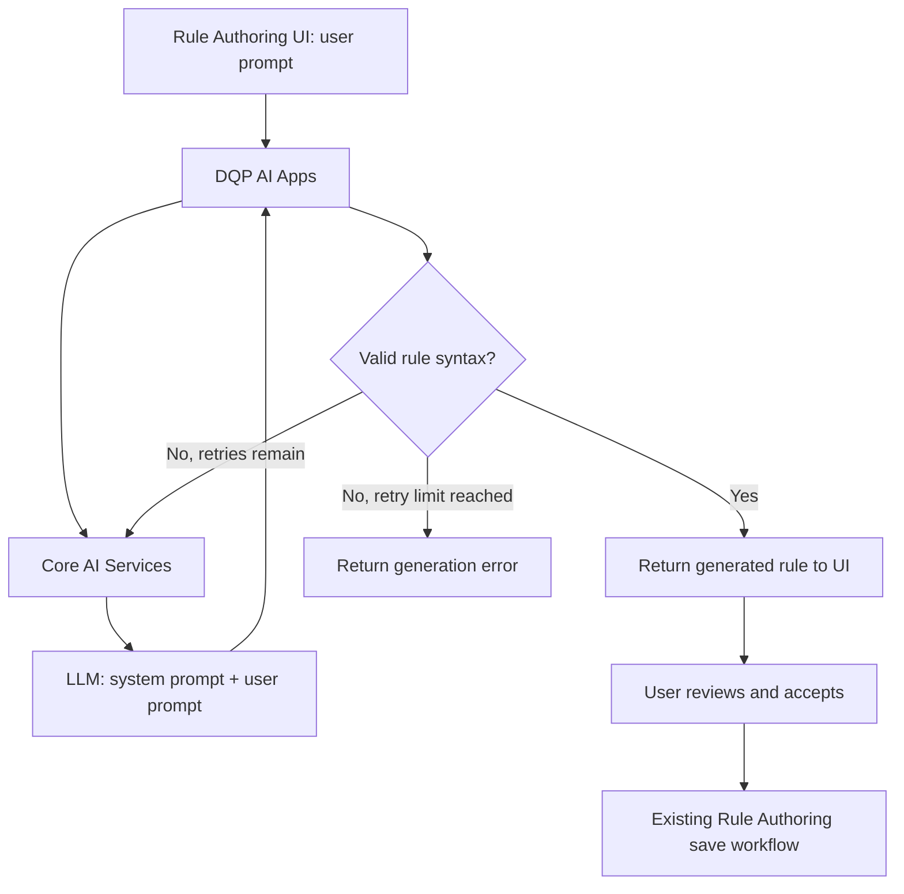
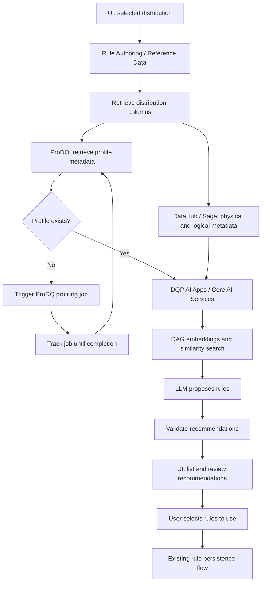
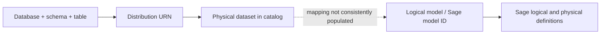

# Meeting 4 Analysis — AI Rule Recommendation

**Source:** Meeting 4 transcript, parts 4.a–4.e  
**Context:** Data Quality Rule Recommendation project  
**Target discussed:** December 18, 2026 — UAT readiness, **not** production readiness

> **Executive conclusion:** Meeting 4 significantly expanded the scope from natural-language-to-DQDL generation toward a metadata-driven rule recommendation platform. The highest-priority capability is generating SQL rule recommendations using profiling and model metadata. The team has a clearer approach for natural-language generation than for profile-driven recommendations, which depend on poorly understood or incomplete ProDQ, Sage, and DataHub integrations. The December 18 target was requested, **not explicitly committed to** by the team.

## 1. Executive summary

The meeting reveals several important shifts:

- **Priority:** Profile-driven SQL rule recommendations are more important to stakeholders than basic English-to-rule generation.
- **Scope:** Natural-language-to-DQDL/SQL remains a desired capability, but the broader target also includes profiling, logical/physical metadata, RAG, vector search, and potentially multiple recommended rules per distribution.
- **Timeline:** Approximately six calendar weeks were discussed, with holidays and existing sprint responsibilities reducing actual capacity.
- **Primary blocker:** The team does not yet know how to retrieve, trigger, monitor, and consume ProDQ profiling jobs reliably.
- **Metadata blocker:** The DQ platform knows distribution URNs, while Sage APIs commonly require model IDs. Legacy dataset-to-model mappings and Sage adoption are incomplete.
- **Frontend change:** One-rule natural-language generation can remain in the existing rule modal; distribution-level recommendations require a broader, asynchronous review-and-select experience.
- **Delivery realism:** The team explicitly questioned feasibility and did not promise to deliver the full scope by December 18.

## 2. Original versus expanded scope

| Dimension | Original direction | Meeting 4 direction |
|---|---|---|
| Primary capability | English → DQDL | Profile/model metadata → SQL recommendations |
| Additional capability | DQDL generation | English → DQDL and SQL |
| Input | User prompt | Distribution, columns, profiles, physical/logical metadata |
| Output | One rule | Potentially many recommended rules |
| Rule language | DQDL | DQDL and SQL |
| AI approach | Prompt, LLM, syntax validation | RAG, embeddings, vector similarity, LLM, validation |
| Dependencies | AI services and parser | ProDQ, DataHub, Sage, reference data, AI services |
| UX | Generation inside individual rule modal | Distribution-level recommendations, processing status, notifications, selection |
| Delivery | Smaller MVP | Broader UAT milestone |

The distinction is fundamental: a natural-language feature translates explicit user intent (for example, “customer email cannot be null”), while a profile-driven feature **infers** useful checks from column statistics, metadata, and prior rules.

## 3. Two distinct architecture workflows

### A. Natural-language rule generation



The meeting discussed validation and up to three generation attempts. DQP AI Apps appears intended to coordinate generation and validation, while Core AI Services supplies LLM and retrieval capabilities. For SQL, the team still needs an agreed validation strategy; a DQDL parser cannot validate arbitrary SQL.

### B. Metadata-driven recommendation



*This is a conceptual architecture derived from the discussion, not a confirmed API contract.*

### A critical architecture distinction: offline versus online RAG

The conversation sometimes conflates generating feature vectors, indexing historical examples, and creating embeddings during runtime. These should be distinguished:

| Offline preparation | Online recommendation |
|---|---|
| Collect existing rule examples | Receive distribution and metadata context |
| Collect/normalize representative profiles | Retrieve the current profile |
| Associate examples with columns and model information | Embed current search/query context as needed |
| Generate corpus embeddings | Find similar pre-indexed examples |
| Populate/update vector index | Prompt LLM, validate and return results |

**Recommendation:** Avoid rebuilding the historical vector corpus for every user request. Query-time embedding of the current metadata is different from maintaining the stored knowledge base.

## 4. ProDQ is the most immediate dependency

ProDQ profiling is essential to the priority SQL recommendation path, yet basic integration capabilities were unconfirmed.

| Capability | Why it matters | Status in meeting |
|---|---|---|
| Determine whether a profile exists | Choose immediate vs. long-running path | API unclear |
| Retrieve an existing profile | Feed recommendation generation | API unclear |
| Trigger new profiling | Handle distributions without profiles | API unclear |
| Monitor a job | Know when results become available | API unclear |
| Retrieve completed profile | Continue AI generation | API unclear |
| Map distribution URN to ProDQ asset | Retrieve the right dataset | Unresolved |
| Understand duration/error behavior | Design lifecycle and UX | Unresolved |

The conversation suggested ProDQ has executors using ECS containers and connections to databases, but that does **not** establish the availability or behavior of profiling APIs.

**Immediate action:** Meet the ProDQ integration owners and confirm supported endpoints, identifiers, permissions, typical duration, status transitions, and failure modes. Do not estimate the implementation as though those endpoints already exist.

## 5. Sage versus DataHub: identifier and metadata quality gaps

The existing DQ platform generally starts from the dataset's **database + schema + table**, from which it resolves the **distribution URN**. Sage model retrieval, in contrast, relies on **model identifiers**.



The Sage discussion established:

- Sage supports model search, status checks, and physical/logical model downloads when the necessary model identifiers are known.
- Legacy catalog datasets may have no associated Sage model ID.
- The broader governance adoption and model onboarding process is still developing.
- A possible Q2 2027 adoption timeline was mentioned speculatively, **not** as a firm commitment.
- DQ users are consumers of models and are not necessarily the model owners or authors.
- Asking a DQ user to provide a Sage model ID would alter the authoring journey and add significant user burden.

The team considered **DataHub as a near-term metadata workaround**. But it still needs to verify which attributes and descriptions actually exist there and how consistently they are populated.

| Metadata field | Potential rule inference |
|---|---|
| Column name | Basic interpretation |
| Data type | Type-compatible checks |
| Nullable indicator | Completeness |
| Primary key | Uniqueness/completeness |
| Field length | Length bounds |
| Profile min/max | Range checks |
| Business description | Semantic/business meaning |
| Logical relationships | Multi-column and relationship checks |

Without business descriptions, technical rules are still possible, but semantically sophisticated recommendations become less reliable. An abbreviated column like `CSTR_MGT_CD` cannot be interpreted confidently from its name alone.

**Recommendation:** Inspect actual DataHub responses for a small, representative sample of distributions before committing to semantic recommendations.

## 6. Frontend: two different user experiences

### A. Natural language belongs in the existing rule modal

The previously proposed **Manual / Generate with AI** modes remain appropriate for **one individual rule**. Rule name and description stay consistent; the authoring mode determines whether the user edits DQDL/SQL directly or submits a natural-language prompt.

The meeting discovered an existing `authoringLanguage` field and executor-related frontend/backend behavior. The team appeared to confirm that language is tied to the **rule set**, rather than varying freely from rule to rule, but that needs code-level verification.

**UX implication:** Do not add a redundant DQDL/SQL toggle inside an existing rule set if the rule language is already established by the rule-set context. Investigate the ProDQ/onboarding implementation before introducing new controls.

### B. Profile-driven suggestions need a distribution-level interface

The system may produce many suggestions across multiple columns, possibly dozens. This differs from generating one rule in a focused modal.

Suggested interaction:

1. User opens an existing distribution/rule set.
2. User requests AI recommendations.
3. System retrieves profile and model metadata or starts profiling if necessary.
4. User sees progress and can leave while processing continues.
5. Recommendations become available as a list with rule names, involved columns, proposed expression, and rationale.
6. User reviews/edits candidates, selects desired rules, and adds them using the established rule-authoring/persistence flow.

**Proposed conceptual UI:**

```text
AI Rule Recommendations — Selected Distribution

[ ] Customer ID completeness
    customer_id — primary key and non-nullable

[ ] Email completeness
    email_address — profile indicates missing values

[ ] Transaction amount range
    transaction_amount — numeric column with observed bounds

[Review selected rules]
```

These example recommendations illustrate UX, not results actually generated in the meeting.

### Recommended frontend state model

| State | Meaning | User-facing behavior |
|---|---|---|
| Checking metadata | Determining available profile/model information | Initial progress |
| Profiling | No profile exists; profiling is running | Explain analysis and allow user to leave |
| Generating | AI pipeline is preparing recommendations | Processing status |
| Completed | Recommendations returned | Review and select |
| Completed, empty | Process succeeded but found no suitable suggestions | Informative empty state |
| Failed | Profile/retrieval/generation error | Actionable error and retry, where possible |

A **successful run with zero recommendations** is not the same thing as a system failure.

Long-running profiling must not be modeled merely as a spinner attached to a single HTTP request. The product needs job identity, persistent status, and a return path. Email or other notifications with links to generated recommendations were discussed but are **not yet designed or confirmed**.

### Proposed TypeScript API contract (not an existing contract)

```typescript
type RecommendationJobStatus =
  | "QUEUED"
  | "PROFILING"
  | "GENERATING"
  | "COMPLETED"
  | "FAILED";

interface RecommendationJob {
  jobId: string;
  distributionUrn: string;
  status: RecommendationJobStatus;
  recommendations?: RuleRecommendation[];
  error?: {
    code: string;
    message: string;
  };
}

interface RuleRecommendation {
  id: string;
  columnNames: string[];
  authoringLanguage: "DQDL" | "SQL";
  expression: string;
  rationale: string;
}
```

This is a conversation starter for FE/BE design. Confirm whether jobs can be resumed across sessions and whether result persistence and notifications are required.

## 7. Decisions versus unresolved topics

| Topic | Direction discussed | Confidence |
|---|---|---|
| Dec 18 delivery | UAT, not production | High |
| Business priority | Profiling/model metadata → SQL recommendations | High |
| Natural-language generation | Still desired | High |
| Rule language | Derived from existing rule-set context | Medium–high, verify |
| Natural-language trigger | At individual-rule authoring | Medium–high |
| Profile recommendation UI | Distribution-level review | Proposal, not finalized |
| SQL profile source | ProDQ | High |
| DQDL profiling source | Existing Rule Authoring system | High |
| Logical/physical metadata | Sage preferred long term; DataHub being explored | Medium |
| Generation validation | DQP AI Apps | Medium–high |
| RAG infrastructure | Core AI Services | High |
| Notifications | Useful for delayed recommendations | Proposed |
| Number of rules | Multiple possible | High; no fixed limit |

### Unresolved questions

1. How is a distribution mapped to its ProDQ profiling asset?
2. Can ProDQ actually trigger, monitor and retrieve profiling through supported APIs?
3. What usable descriptions and model attributes are present in DataHub for real datasets?
4. What examples constitute the golden dataset, and how are rules tied to one or several columns?
5. Are single-column rules sufficient for UAT, or are complex business and multi-column rules mandatory?
6. Who owns persistence for generated recommendations and long-running job state?
7. How will SQL rules be validated semantically as well as syntactically?
8. How will a user revisit a job after navigating away or losing their session?
9. What happens when profiling cannot run, fails, or produces no usable results?
10. Which requirements are mandatory for December 18 and which can be deferred?

## 8. Delivery risks

| Risk | Assessment | Reason |
|---|---|---|
| ProDQ integration | **Critical** | Core APIs and workflow are unknown |
| Sage/DataHub metadata | **High** | Missing model mappings and inconsistent business descriptions |
| Six-week target | **High** | Scope expansion, holidays, other sprint work |
| RAG/golden dataset | **High** | Example selection and corpus representation unsettled |
| Frontend workflow | **Medium–high** | Asynchronous jobs, many recommendations, result selection |
| Natural-language generation | **Relatively lower** | Simpler and better understood, though SQL validation still open |

Risk levels are qualitative analysis, not measured probabilities.

The team also described recurring local-build breakage associated with Liquibase changes and uncertainty about competing sprint/support obligations. These further reduce effective capacity.

## 9. Recommended implementation sequence

### Workstream 1 — Integration feasibility

Confirm ProDQ APIs, identifiers, permissions, and job behavior. Inspect real DataHub metadata samples. Verify existing `authoringLanguage` semantics and executor selection.

**Exit criterion:** Supported endpoints, sample payloads, documented limitations, and agreed integration owners.

### Workstream 2 — Golden dataset

Create a small representative corpus that links real distributions, profiling outputs, physical/logical metadata, and existing SQL rules. Record missing fields honestly.

**Exit criterion:** Reproducible examples with known candidate checks and transparent metadata gaps.

### Workstream 3 — Recommendation proof of concept

Design the offline vector index, perform retrieval, generate proposed rules, and validate output quality with representative examples.

**Exit criterion:** Meaningful, valid candidate recommendations against the golden dataset.

### Workstream 4 — Product lifecycle and frontend

Agree on request/status/result/error contracts. Build pending, completed, empty and failed states. Support multi-rule review and selection within existing rule persistence constraints.

**Exit criterion:** End-to-end journey that handles delayed profiling and user navigation.

### Workstream 5 — UAT hardening

Test unavailable metadata, permissions, profiling failures, invalid generated expressions, no-recommendation cases, duplicates, and session recovery.

**Exit criterion:** Demonstrable UAT workflow with agreed acceptance criteria and explicitly documented limitations.

Workstreams should overlap where dependencies allow; this is a sequence of priorities, not a rigid waterfall schedule.

## 10. Frontend ownership and leadership opportunity

In part 4.e, the team specifically asked the frontend participant to work through the experience when profiling data is missing, recommendations are delayed, and results eventually become available. This is an opportunity to own the **end-to-end user journey**, not simply implement controls after backend contracts are fixed.

Recommended deliverables:

1. **User journey diagram:** Separate one-rule natural-language authoring from distribution-level profile-driven recommendation.
2. **State machine and API requirements:** Define request initiation, progress, persistence, resume/retry, completion, empty results and errors.
3. **Recommendation review UX:** Show why each rule was proposed, which columns it involves, how multiple rules are selected and how accepted rules use existing validation/save behavior.

Push for backend job identity and stable contracts before the UI is committed to polling or notifications.

## 11. Points to raise at the next meeting

### A. Establish the December 18 minimum UAT scope

The requested deliverable appears to include profiling, model metadata, SQL and DQDL, RAG, generation, and a new user journey. The team should explicitly distinguish requirements from stretch goals and avoid treating a requested deadline as a commitment.

### B. Separate recommendation generation from recommendation delivery

The vector store, embeddings and LLM are implementation concerns. The user-facing contract is: request recommendations, track processing, review results, accept selected rules. Align backend APIs with that journey.

### C. Decide what happens when profiling is missing

Options include automatically starting profiling, requesting confirmation, or limiting the first UAT implementation to datasets already profiled. This decision affects time, cost, permissions, status management and notifications.

## 12. Team and process observations

**Architecture discovery and sprint estimation are happening together.** Participants frequently moved between API questions, RAG design, UI behavior and story sizing. Track confirmed facts, assumptions, architectural decisions and blockers separately.

**External readiness is the leading delivery constraint.** Coding the prompt-to-LLM path seems less uncertain than obtaining correct profile/model metadata and coordinating external job lifecycles.

**Frontend considerations entered the discussion late.** The team described backend processing before fully resolving how users request, wait for, resume and accept recommendations. Defining these journeys early will improve the APIs and reduce rework.

## 13. Final assessment

Meeting 4 clarified that the project is becoming a **metadata-driven rule recommendation platform**, not merely a natural-language rule generator.

The team should recognize two capabilities with different engineering and UX needs:

1. **Natural-language generation:** Individual-rule authoring, an LLM request, validation/retries, and the existing accept/save workflow.
2. **Metadata-driven recommendations:** Distribution-level profiling, model metadata retrieval, RAG, potentially long-running jobs, multiple generated recommendations, and user selection.

They can share Core AI Services but should not be forced into one UI or one execution lifecycle.

**Recommended next milestone:** Demonstrate the complete recommendation lifecycle using a real representative distribution, with verified profile retrieval, meaningful generated candidates, validation, UI review, and a clear statement of what cannot yet be delivered by December 18.

---

*This analysis consolidates meeting transcript parts 4.a–4.e. Proposed architectural refinements, UX states, API types, and workstreams are recommendations, not decisions formally confirmed in the transcript.*
