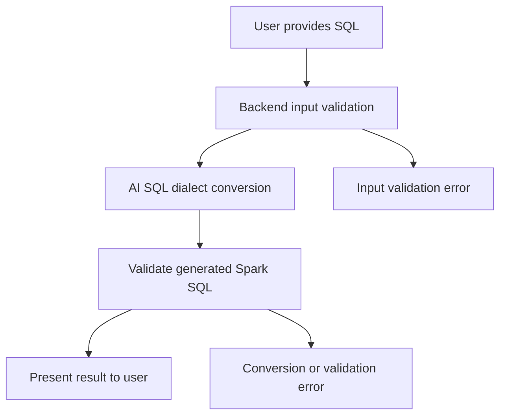
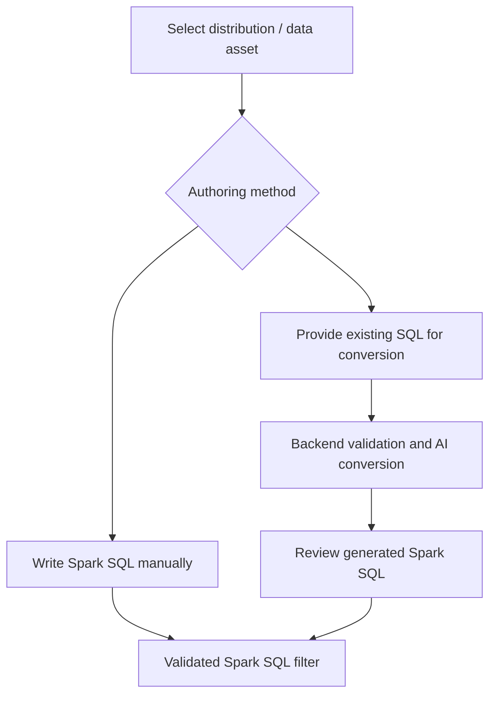
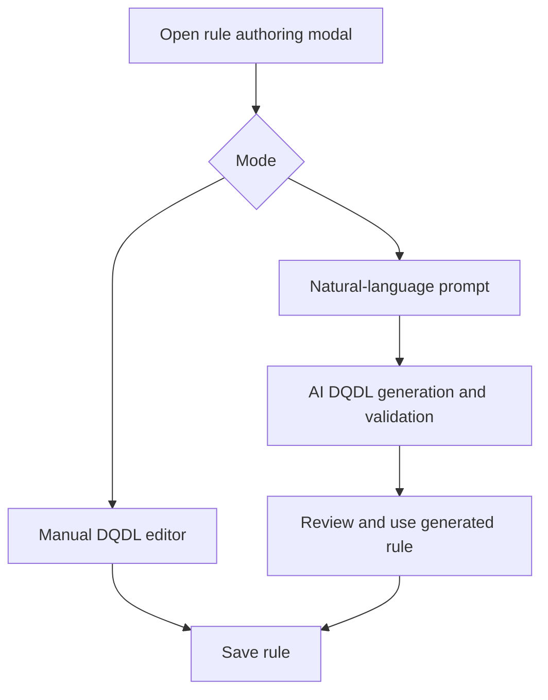
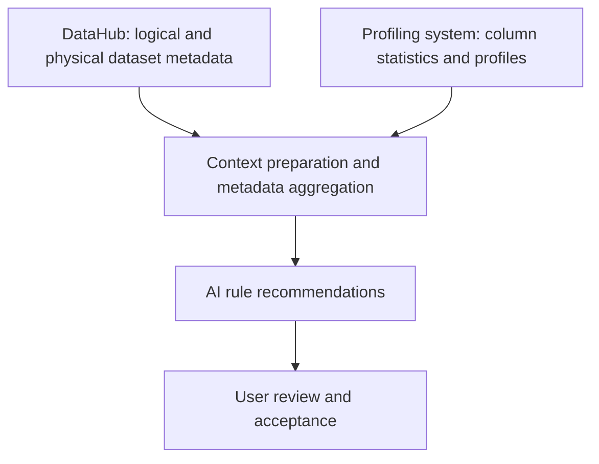

# Meeting 5 Analysis — AI Rule Recommendation

**Date:** November 3, 2026  
**Topics:** Requirements alignment, SQL conversion, AI integration, profile-driven generation

> **Source:** Meeting 5 transcript. This document distinguishes positions expressed during the meeting from recommendations and proposed implementation details.

## 1. Executive Summary

Meeting 5 revealed a significant proposed change to AI functionality for data onboarding, while preserving the existing AI-assisted rule-authoring direction.

The team is considering replacing **natural language → Spark SQL** with **SQL → Spark SQL conversion** for onboarding filters. This would reduce ambiguity and implementation risk for the December timeframe, but final stakeholder approval was not established.

| Capability | Direction | Status |
|---|---|---|
| Natural language → DQDL | Generate data quality rule definitions | Direction retained |
| SQL → Spark SQL | Convert existing SQL for onboarding filters | Proposed; pending confirmation |
| Profile-driven rule generation | Recommendations using metadata and profiling | Parallel investigation; access dependencies |

**Assessment:** The proposed MVP is more bounded, but requirements ownership and the onboarding/rule-authoring boundary still need clarification before significant frontend work.

## 2. Most Important Development: SQL to Spark SQL

The conversation contrasted two capabilities:

- **Natural language → Spark SQL:** Interpret business intent, identify joins and keys, filters, and potentially ask follow-up questions.
- **SQL → Spark SQL:** Convert an existing query or expression while trying to preserve its meaning.

The team viewed the first as a potentially conversational, agentic workflow and the second as a more achievable bounded conversion task.

### Proposed conversion workflow



This is a **proposed interpretation**, not an approved implementation design.

| Natural language → Spark SQL | SQL → Spark SQL |
|---|---|
| Must interpret user intent | Existing query provides structure |
| May need schema and relationship discovery | Existing joins and filters provide context |
| Could require iterative clarification | May support a single conversion request |
| Higher risk of inventing logic | Higher focus on preserving original semantics |
| Stronger case for an agentic system | Possible bounded LLM-assisted workflow |

**Important qualification:** SQL conversion can still be difficult for dialect-specific functions, null semantics, type coercion, dates, nested queries, and unsupported constructs.

## 3. Two Distinct AI Workflows

The transcript differentiates **onboarding filters** from **DQDL rules**.

### Workflow A — Data onboarding (pending approval)



### Workflow B — Rule authoring (direction retained)



The filter workflow should not be equated with rule definition generation simply because both use AI. They have different inputs, validation requirements, and user journeys.

## 4. Frontend UX Implications

The team discussed whether conversion should be exposed through a separate box, a toggle, a conversion button, or automatic detection. No final UI pattern was selected.

### Recommended concept: Explicit conversion mode

**Configure Data Filter**

- **Write Spark SQL:** Existing manual SQL editor; no AI required.
- **Convert SQL with AI:** Paste source SQL, request conversion, review and edit the returned Spark SQL before using it.

The conversion action should be explicit rather than silently rewriting pasted text.

### Why this pattern

1. **Discoverability:** Users can see that conversion exists.
2. **Control:** Existing Spark SQL users are not forced through AI.
3. **Predictability:** Pasting code does not trigger unexpected transformation.
4. **Resilience:** Manual authoring remains available if AI is down.
5. **Traceability:** Manual and AI-assisted results can be distinguished.

**Open UX question:** Does onboarding accept a whole query, a `WHERE` condition, or both? This needs to be specified before finalizing the editor and conversion contract.

## 5. Backend Responsibilities and Validation

The conversation proposed input validation, checks for disallowed operations such as `DELETE`, AI conversion, and validation of the resulting Spark SQL. Participants expected much of this logic to reside in the backend.

| Layer | Proposed responsibility |
|---|---|
| React frontend | Input, conversion trigger, loading/errors, review and editing |
| Conversion API | Receive source SQL and target dialect |
| Input validator | Syntax and permitted-statement checks |
| AI conversion service | Translate between SQL dialects |
| Output validator | Validate generated Spark SQL |
| Response contract | Return converted SQL, status, and diagnostics |

### Suggested API separation (not agreed endpoints)

```http
POST /api/ai/dqdl/generate
POST /api/ai/sql/convert
```

The services might share model invocation, retry, metrics, and error-handling infrastructure. Their domain-specific validators should remain separate.

**Critical point:** Syntactically valid SQL may still produce incorrect results. SQL conversion acceptance must address semantics, not just parsing.

## 6. Proof of Concept Before Commitment

A participant recommended testing with an actual complicated query in LM Suite before committing to conversion capabilities. The proposed experiment included converting SQL to Spark SQL, converting back, and comparing the outcomes.

### Recommended POC extension

1. Obtain representative complex queries from actual users.
2. Attempt source SQL → Spark SQL conversion.
3. Parse and validate generated Spark SQL.
4. Where feasible, compare behavior against controlled sample datasets.
5. Test difficult scenarios: joins, nested queries, aggregations, window functions, date/time functions, nulls, implicit casting, and dialect-specific functions.
6. Record success/failure categories and manual corrections required.

**Caution:** Round-trip text similarity is a weak proxy for semantic equivalence.

## 7. Profile-Driven Rule Generation

A separate discussion concerned generating rules from metadata and data profiling. The team mentioned using **DataHub** for logical and physical dataset metadata and an external profiling system (transcription of its name is uncertain).



### Observed dependencies

- DataHub metadata investigation is ongoing.
- Profiling APIs appear to be available.
- Profiling integration may need tenant/job identifiers and relationships across databases and tables.
- Required production profiling data access was not yet available to the team.
- A December target or possible availability was discussed, without firm confirmation.

**Recommendation:** Keep this investigation parallel to the core MVP rather than making external profiling access a prerequisite for DQDL generation or SQL conversion.

## 8. Decisions vs. Open Questions

| Topic | Meeting status |
|---|---|
| Natural language → DQDL in rule authoring | Direction reaffirmed |
| SQL → Spark SQL in onboarding | Strongly discussed; awaiting final approval |
| Agentic natural language → Spark SQL | Recommended against for the near-term MVP |
| Manual Spark SQL editing | Supported in discussion |
| Backend validation | Intended architecture; details unspecified |
| Shared AI implementation | Some reusable infrastructure; separate flow needed |
| Toggle, button, separate input, or automatic detection | Unresolved |
| Full SQL query vs. filter-only conversion | Unresolved |
| DataHub/profile-driven recommendations | Parallel exploration |
| Production profiling access | Blocked or uncertain |
| December deliverables | Require explicit confirmation |

## 9. Risks and Gaps

### High: Requirements volatility

The onboarding AI capability appears to be shifting mid-discussion. Implementation without approval risks avoidable rework.

### High: SQL semantic correctness

An output can pass syntax validation yet alter query behavior. The team needs defined test cases, accepted dialects, and validation ownership.

### Medium: UX ambiguity

Automatic detection, a conversion button, and two modes create different expectations and error behaviors. The preferred UX needs agreement.

### Medium: Profiling dependency

Having APIs does not equal having the right production dataset access or a stable integration contract.

### Medium: AI outage and error behavior

Manual authoring was mentioned as a fallback, but the API error contract, retries, state preservation, and failure messaging remain unspecified.

## 10. Recommended Action Items

These are **proposed actions and owners**, not formally assigned meeting commitments.

| Priority | Action | Suggested owner |
|---|---|---|
| P0 | Confirm SQL → Spark SQL vs. natural language → Spark SQL | Product / stakeholders |
| P0 | Define full-query vs. filter-expression scope | Product + backend + frontend |
| P0 | Run POC with representative complex SQL | Backend / AI |
| P1 | Agree on API input/output and error contracts | Backend + frontend |
| P1 | Produce lightweight onboarding UI proposal | Frontend |
| P1 | Preserve existing DQDL authoring unless requirements change | Frontend + backend |
| P1 | Define input restrictions and output validation criteria | Backend / AI |
| P2 | Investigate DataHub and profiling data access | Data integration |
| P2 | Define profile metadata integration and dependencies | Architecture / backend |

### Proposed frontend acceptance criteria

- Users may continue manually entering Spark SQL.
- Users may explicitly invoke source-SQL conversion.
- Input text remains available after an error.
- Converted SQL is reviewed and editable before use.
- API validation errors are shown clearly.
- AI failure does not block manual entry.
- Non-AI onboarding behavior remains unchanged.

## 11. Team Dynamics and Engineering Process

One participant said they had already spent roughly **three sprints** researching a SQL converter, producing diagrams and an RFC, before that work was scrapped. Similar functionality is now being reconsidered.

That earlier work may help accelerate a new POC, and it highlights the cost of unstable requirements.

The frontend engineer asked whether to wait for confirmation before making implementation changes. The discussion supported thinking through potential designs but did **not** establish final approval for implementation.

**Practical distinction:** Explore a flexible UX concept now; avoid committing major development effort until the workflow and contract are approved.

## 12. Recommended Leadership Move

Present a short, explicit decision proposal at the next discussion.

### Proposed December scope

- **Rule authoring:** Retain natural language → DQDL generation in the existing modal.
- **Onboarding:** Add SQL → Spark SQL conversion only after stakeholder approval and a successful POC.
- **Manual fallback:** Preserve direct Spark SQL editing.
- **Deferred:** Conversational, agentic natural language → Spark SQL generation.
- **Parallel discovery:** Profile-driven recommendations from DataHub and profiling metadata.

### Decision question

> For the December MVP, can we confirm that the onboarding AI feature accepts existing SQL and converts it to Spark SQL, while rule authoring continues to support natural-language DQDL generation? Also, are we converting complete SQL queries, filter expressions, or both?

This resolves a large part of the uncertainty affecting frontend design, API contracts, and validation.

## 13. Overall Conclusion

Meeting 5 was a **scope-alignment discussion**, not a final implementation sign-off.

- Natural-language DQDL authoring remains central to AI-assisted rule generation.
- SQL → Spark SQL is emerging as the more achievable onboarding feature.
- Open-ended agentic natural-language SQL generation is considered too broad for the near-term timeline.
- Profile-driven generation has external metadata and data-access dependencies.

**Architecture takeaway:** Avoid collapsing all three capabilities into one generic AI workflow just because they invoke a language model.

**Delivery takeaway:** Confirm input/output contracts and user journeys before changing the frontend.

**Leadership opportunity:** Own the onboarding user experience and surface the API decisions required to implement it, rather than allowing backend constraints to dictate the workflow after the fact.
