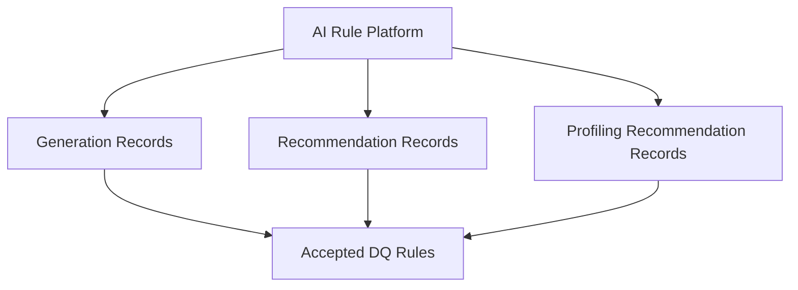
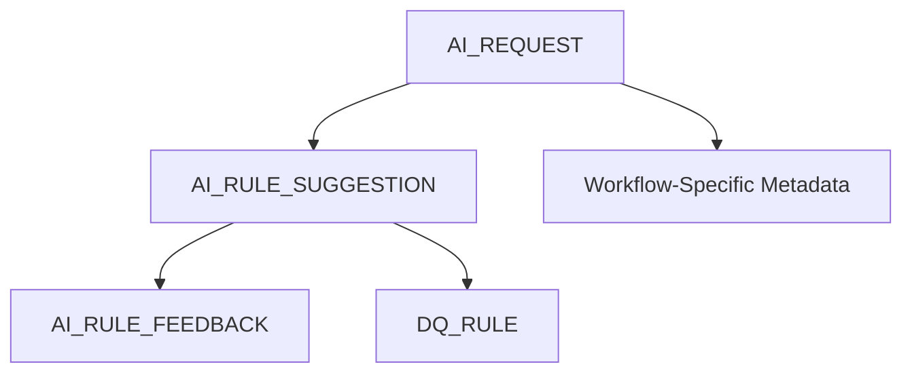
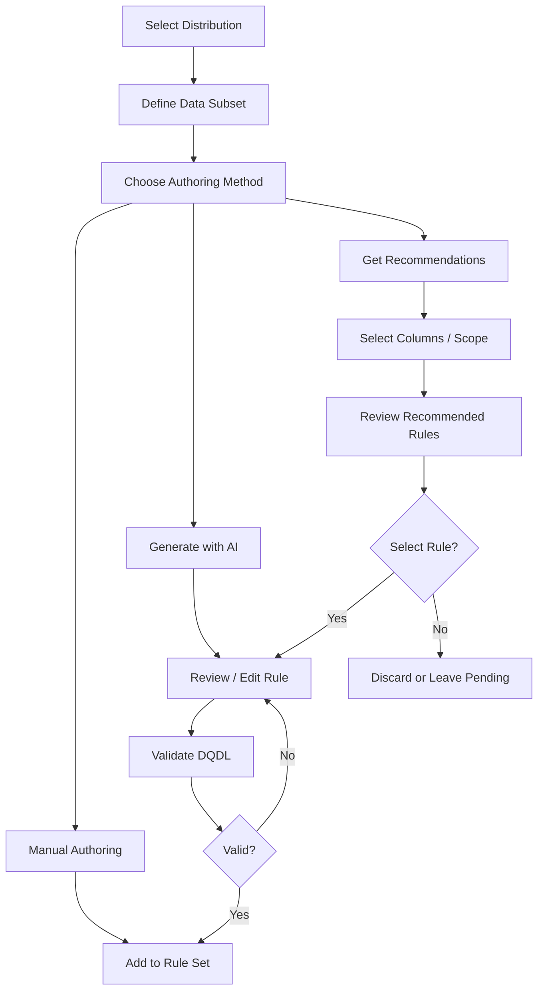

# Meeting 7 Analysis — AI Rule Recommendation & Generation

**Project:** Data Quality Rule Recommendation  
**Meeting:** 7  
**Date:** November 2026  
**Focus:** Database Architecture, AI Recommendations, User Experience, and Acceptance Tracking

---

## 1. Executive Summary

Meeting 7 focused on two major architectural and product design challenges:

1. **Database Architecture:** Should AI rule recommendations, AI-generated rules, and profiling-based recommendations share one database table, or should each workflow have separate persistence structures?
2. **User Experience:** How should users review, select, accept, reject, and modify AI-recommended data quality rules when the system potentially produces dozens or hundreds of recommendations?

The discussion revealed that the project is evolving beyond the initial AI rule generation MVP toward a broader AI-powered data quality recommendation platform.

### Key Takeaways

- The team discussed consolidating recommendation and generation data into a common persistence model.
- A single database table with JSON request/response payloads was considered.
- Separation of concerns remains an architectural concern.
- Each recommended rule needs independent acceptance or rejection tracking.
- Recommendation volume could overwhelm users.
- Column selection and recommendation filtering were proposed as possible solutions.
- Users need both English descriptions and executable DQDL expressions.
- Users should be able to modify recommended rules.
- Manual rule authoring must remain available.
- The team identified an existing business request that should inform future UX decisions.

**Overall Assessment:** The meeting identified important architectural and UX challenges, but several major decisions remain unresolved.

---

## 2. AI Workflows Under Discussion

The team discussed three related but distinct AI workflows.

### 2.1 AI Rule Generation

Users provide a natural-language description, and the AI generates an executable rule.

**Example Input:**

> Generate a rule that ensures customer_email is not null.

**Example Output:**

```dqdl
Rules = [
  IsComplete "customer_email"
]
```

### 2.2 AI Rule Recommendation

The system examines available metadata, selected columns, and potentially existing rules to recommend useful data quality checks.

**Example Input:**

```json
{
  "distributionId": "distribution-123",
  "selectedColumns": [
    "customer_email",
    "customer_age"
  ]
}
```

**Example Output:**

```json
{
  "recommendations": [
    {
      "description": "Customer email must not be null.",
      "expression": "IsComplete \"customer_email\""
    },
    {
      "description": "Customer age must be non-negative.",
      "expression": "ColumnValues \"customer_age\" >= 0"
    }
  ]
}
```

### 2.3 Profiling-Based Rule Recommendation

The system uses profiling results to identify potential data quality checks.

Examples include:

- Missing values
- Unexpected null percentages
- Invalid formats
- Duplicate identifiers
- Unexpected statistical distributions
- Invalid categorical values

The recommendation engine can then suggest rules based on these findings.

### Architectural Implication

Although these workflows may share AI infrastructure, they have different business contexts.

The architecture should distinguish between:

1. Recommendation requests
2. Generated suggestions
3. User decisions
4. Persisted data quality rules

These concepts should not automatically be treated as identical database entities.

---

## 3. Database Architecture Discussion

The first major discussion concerned the database design.

The team considered whether multiple existing tables could be consolidated.

### 3.1 Option A — One Consolidated Table

A possible schema:

```sql
CREATE TABLE ai_rule_recommendation (
    id UUID PRIMARY KEY,
    workflow_type VARCHAR(50),
    rule_type VARCHAR(50),
    request_json JSON,
    response_json JSON,
    status VARCHAR(30),
    created_at TIMESTAMP
);
```

#### Advantages

- Fewer database tables
- Centralized recommendation history
- Common acceptance/rejection tracking
- Simpler initial implementation
- Easier access to records across workflows

#### Disadvantages

- Limited separation of concerns
- Different workflows may require different metadata
- Heavy dependence on JSON structures
- More complicated analytics queries
- Potential schema inconsistencies
- Difficult long-term maintenance if workflows diverge

One participant suggested that developers could query JSON payloads when they needed workflow-specific information.

However, another concern was whether this would genuinely simplify the system or merely move complexity into application code and JSON queries.

### 3.2 Option B — Separate Workflow Tables

An alternative architecture would create specialized tables for each workflow.



#### Advantages

- Clear separation of concerns
- Workflow-specific schemas
- Easier validation of workflow-specific fields
- Better isolation of future changes

#### Disadvantages

- Duplicate information
- More tables and relationships
- More complex unified analytics
- Additional backend development

### 3.3 Recommended Architecture — Shared Core with Specialized Metadata

A hybrid model provides a reasonable balance.



#### AI_REQUEST

Stores the generation or recommendation request.

```sql
CREATE TABLE ai_request (
    id UUID PRIMARY KEY,
    workflow_type VARCHAR(50) NOT NULL,
    distribution_id UUID,
    request_payload JSON,
    created_at TIMESTAMP NOT NULL
);
```

#### AI_RULE_SUGGESTION

Stores individual recommendations.

```sql
CREATE TABLE ai_rule_suggestion (
    id UUID PRIMARY KEY,
    request_id UUID NOT NULL,
    rule_type VARCHAR(50),
    english_description TEXT,
    rule_expression TEXT,
    decision_status VARCHAR(30),
    response_payload JSON,
    created_at TIMESTAMP NOT NULL,

    FOREIGN KEY (request_id)
        REFERENCES ai_request(id)
);
```

#### AI_RULE_FEEDBACK

Records user decisions and feedback events.

```sql
CREATE TABLE ai_rule_feedback (
    id UUID PRIMARY KEY,
    suggestion_id UUID NOT NULL,
    event_type VARCHAR(50) NOT NULL,
    feedback_payload JSON,
    created_at TIMESTAMP NOT NULL,

    FOREIGN KEY (suggestion_id)
        REFERENCES ai_rule_suggestion(id)
);
```

This structure allows:

- One request to generate multiple suggestions
- Each suggestion to have its own decision status
- Workflow-specific metadata to remain flexible
- Feedback to be recorded separately
- Accepted suggestions to be associated with persisted rules

**Recommendation:** Avoid designing entirely separate systems for generation and recommendation, but also avoid forcing all workflow data into a single unstructured table.

---

## 4. Individual Rule Acceptance Tracking

The team reached a relatively clear direction: each recommended rule should have its own acceptance state.

### Example

Suppose a recommendation job returns five rules.

| Rule | Description | Decision |
|---|---|---|
| R1 | Email must not be null | ACCEPTED |
| R2 | Age must be positive | REJECTED |
| R3 | Account ID must be unique | ACCEPTED |
| R4 | Date must be valid | PENDING |
| R5 | Status must be populated | PENDING |

A single recommendation request can therefore contain mixed decisions.

### Recommended TypeScript Model

```typescript
type RecommendationDecision =
  | "PENDING"
  | "ACCEPTED"
  | "REJECTED";

interface RuleSuggestion {
  id: string;
  requestId: string;
  description: string;
  expression: string;
  decision: RecommendationDecision;
}
```

### Important Consideration

**Pending does not mean rejected.**

A user may close the recommendation experience without reviewing all suggestions.

Those remaining suggestions should not necessarily be classified as rejected.

### Analytics Opportunities

Tracking individual recommendations enables the team to answer:

- Which rule types are most frequently accepted?
- Which recommendations are frequently rejected?
- Which columns produce useful recommendations?
- How often do users abandon recommendation sessions?
- How often do users modify AI-generated rules?
- Which recommendation workflows produce the highest adoption rates?

These metrics can support future improvements to recommendation quality.

---

## 5. Major UX Challenge — Recommendation Overload

The team raised concerns about the number of recommendations generated for large datasets.

### Example

Assume:

- A distribution contains 100 columns.
- The recommendation service generates 3 rules per column.

The system could return:

```text
100 columns × 3 rules = 300 recommendations
```

If users spend 15 seconds reviewing each rule:

```text
300 × 15 seconds = 4,500 seconds

Total = 75 minutes
```

This creates significant user friction.

### Key Concern

A participant pointed out that users might abandon the recommendation experience if reviewing the results becomes more work than writing the rules manually.

This is a critical product risk.

The system should not simply optimize for generating more recommendations.

It should optimize for producing recommendations that users can efficiently evaluate and adopt.

---

## 6. UX Approaches Discussed

### Option A — Accept or Reject Rules Individually

Each recommendation has an acceptance or rejection action.

**Advantages:**

- Explicit human review
- Clear individual decision tracking
- Lower risk of accidentally accepting unwanted rules

**Disadvantages:**

- Excessive clicking
- Poor experience with large result sets
- High review effort

### Option B — Accept All Recommendations

Users can accept an entire recommendation batch.

**Advantages:**

- Fast
- Convenient for large batches
- Minimal interactions

**Disadvantages:**

- Users may accept incorrect rules without reviewing them
- Potential data quality governance concerns
- Could introduce unnecessary rules

The meeting did not establish agreement on allowing bulk acceptance.

### Option C — Return Only Top Recommendations

Instead of generating many recommendations, the service returns the top three to five suggestions.

**Advantages:**

- Smaller review workload
- Easier UI
- Encourages focusing on higher-value checks

**Disadvantages:**

- Requires recommendation ranking
- Useful recommendations may be excluded
- The system may not know the user's specific priorities

### Option D — Select Columns Before Generation

Users choose which columns should be considered.

Example:

```text
Selected columns:

[x] customer_email
[x] customer_age
[x] account_status
[ ] account_id
[ ] created_date
```

The recommendation service generates rules only for selected columns.

**Advantages:**

- Smaller recommendation sets
- Better user control
- Potentially lower AI processing costs

**Disadvantages:**

- Users may need to repeat generation
- Users must know which columns are important
- Potentially limits discovery

### Option E — Generate Broadly and Filter Results

Generate recommendations for the distribution, then allow users to filter by column.

**Advantages:**

- Flexible exploration
- No repeated generation required for filtering
- Supports discovery across the dataset

**Disadvantages:**

- More compute and storage
- Larger response sets
- May require pagination and caching

### Option F — Precompute Recommendations

The system generates recommendations ahead of time.

**Advantages:**

- Faster perceived response
- Less waiting during user interaction
- Recommendations may already be available when users open the interface

**Disadvantages:**

- Additional infrastructure
- Staleness concerns
- Increased compute costs
- Requires scheduling and invalidation strategies

### Recommended UX Approach

Combine:

1. Column selection and filtering
2. Grouped recommendation results
3. English descriptions
4. DQDL previews
5. Multiple selection
6. Explicit review before saving

This supports efficient selection while preserving user control.

---

## 7. Proposed Recommendation UI

### Recommended Data Quality Rules

The interface could display:

```text
--------------------------------------------------
Recommended Data Quality Rules

Distribution: Customer Accounts

Filter by Column: [ All Columns       v ]

4 Recommendations

[x] customer_email
    Completeness

    Customer email must not be null.

    DQDL:
    IsComplete "customer_email"

--------------------------------------------------

[ ] customer_age
    Validity

    Customer age must be non-negative.

    DQDL:
    ColumnValues "customer_age" >= 0

--------------------------------------------------

[x] account_id
    Uniqueness

    Account ID must be unique.

    DQDL:
    IsUnique "account_id"

--------------------------------------------------

[ ] account_status
    Completeness

    Account status must be populated.

    DQDL:
    IsComplete "account_status"

--------------------------------------------------

2 Rules Selected

[ Cancel ]       [ Review Selected Rules ]
--------------------------------------------------
```

### UX Principles

- Show human-readable descriptions first.
- Allow users to inspect the underlying executable rules.
- Support filtering by columns.
- Allow users to select multiple recommendations.
- Provide a clear review step.
- Do not automatically save all recommendations.
- Preserve manual rule authoring.

### Important Distinction

**Bulk selection is not the same as bulk acceptance.**

Users may select multiple recommendations for review without automatically persisting them.

This distinction can satisfy both efficiency and governance requirements.

---

## 8. Business Requirements Discovered During the Meeting

Toward the end of the meeting, a participant located an earlier user request.

This provided more concrete product requirements.

### Identified Requirements

| Requirement | Description |
|---|---|
| English recommendations | Explain business rules in natural language |
| Multiple columns | Support rules involving multiple fields |
| Simple rules | Recommend basic single-column checks |
| Compound rules | Recommend checks involving multiple conditions |
| DQDL visibility | Display executable expressions |
| Rule selection | Allow users to select desired recommendations |
| Rule editing | Allow users to modify selected rules |
| Manual fallback | Allow users to write their own rules |
| Column selection | Allow users to specify columns for recommendations |

The transcript also suggests using selected data subsets and existing rules as inputs, but the exact requirement needs confirmation.

### Why Compound Rules Matter

A simple rule checks one column:

```dqdl
Rules = [
  IsComplete "customer_email"
]
```

A compound business rule may involve several columns.

Example:

> If account_status is CLOSED, account_closure_date must not be null.

This requires understanding relationships between columns.

### Proposed Data Model

```typescript
interface RecommendedRule {
  id: string;
  description: string;
  expression: string;
  columns: string[];
  ruleType: "SIMPLE" | "COMPOUND";
}
```

Notice that `columns` is an array.

This prevents the UI and API from assuming that every recommendation belongs to exactly one column.

---

## 9. Recommended End-to-End Workflow

The following represents a proposed workflow rather than an agreed implementation.



### Workflow Responsibilities

#### Manual Authoring

The user writes and validates a rule using the existing rule authoring experience.

#### Generate with AI

The user provides a natural-language description and receives a generated rule.

#### Get Recommendations

The system recommends rules based on available data context and metadata.

#### Review and Accept

The user evaluates individual recommendations and chooses which rules should become part of the authored rule set.

### Architectural Recommendation

All three paths should converge into a consistent rule validation and authoring workflow.

This avoids maintaining completely separate editing experiences.

---

## 10. Analysis of Mike's Contributions

Mike was asked directly for his opinion on how users should handle a large recommendation set.

### 10.1 Initial Suggestion

Mike suggested allowing users to either:

- Save all recommended rules
- Select individual rules

This introduced alternatives to individually clicking Accept or Reject for every recommendation.

### 10.2 Connecting the Discussion to the Existing UI

Mike referenced the existing profiling grid.

He attempted to determine how the recommended rules would fit into the current product.

One important question was:

> Where are we planning to display these recommended rules?

This was valuable because the team was discussing detailed acceptance mechanics before defining where the user would encounter the recommendations.

### 10.3 Strengths

**Product Awareness**

Mike connected the discussion to an existing user interface rather than treating recommendations as an isolated backend feature.

**UX Flexibility**

He explored multiple interaction patterns instead of assuming individual acceptance was the only option.

**Identifying Missing Requirements**

He recognized that recommendation placement needed clarification before finalizing the interaction model.

### 10.4 Areas for Improvement

At one point, another participant said they did not fully understand the proposed experience.

A more structured explanation could have helped.

### Suggested Communication

> I propose displaying the recommendation response as a selectable list of candidate rules.
>
> Each recommendation would display its associated columns, English description, and DQDL expression.
>
> Users could select multiple recommendations, review them, and then add the approved rules to their rule set.
>
> Before deciding whether to support bulk acceptance, we should establish where this recommendation experience belongs within the existing workflow.

This explanation clearly identifies:

1. The UI component
2. The information displayed
3. The user interactions
4. The acceptance process
5. The unresolved product decision

### Leadership Opportunity

Mike can provide value by translating backend discussions into a concrete end-to-end user experience.

A UX prototype accompanied by an API contract would help align the frontend, backend, and AI teams.

---

## 11. Confirmed Directions vs. Open Questions

### Relatively Clear Directions

- Recommended rules require user review.
- Recommendations should not automatically become authored rules.
- Each suggestion needs independent decision tracking.
- Human-readable descriptions are important.
- Users need access to executable rules.
- Manual rule authoring must remain available.
- Recommendation overload is a real UX concern.

### Unresolved Decisions

| Question | Status | Suggested Owner |
|---|---|---|
| Single table vs. multiple tables | Open | Backend / Architecture |
| Recommendation UI placement | Open | Frontend / Product |
| Individual vs. bulk acceptance | Open | Product / UX |
| Recommendation count limits | Open | Product / AI |
| Column selection timing | Open | Product / UX |
| Precomputed recommendations | Open | Backend / AI |
| Editing before or after acceptance | Needs clarification | Product / Frontend |
| Tracking edited AI rules | Open | Architecture |
| Grouping compound rules | Open | Product / Frontend |

These decisions should be tracked explicitly rather than treated as implied agreements.

---

## 12. Engineering Risks

### Risk 1 — Recommendation Volume

Large datasets could produce hundreds or thousands of suggestions.

Potential consequences:

- Large API payloads
- Slow rendering
- Excessive review effort
- Increased AI processing costs
- Potential need for pagination or virtualization

**Mitigation:** Support filtering, grouping, and progressive review.

### Risk 2 — Inconsistent Acceptance Tracking

A recommendation could be marked accepted before the corresponding rule is successfully validated or persisted.

**Mitigation:** Distinguish recommendation selection, acceptance, validation, and successful rule creation.

### Risk 3 — Compound Rule Modeling

A strictly single-column model may not support rules involving multiple columns.

**Mitigation:** Represent associated columns as a collection.

### Risk 4 — Duplicate Rule Recommendations

AI could suggest rules that already exist.

**Mitigation:** Consider existing rule definitions during recommendation generation and perform duplicate checks.

### Risk 5 — Insufficient Analytics

Recording only a final acceptance status may not provide enough information to improve the recommendation engine.

**Mitigation:** Preserve the original suggestion, relevant context, and the final accepted or edited version.

### Risk 6 — Divergent Workflows

Generation and recommendation features could evolve into independent UI experiences with duplicated editing and validation behavior.

**Mitigation:** Reuse the existing rule-authoring components where practical.

---

## 13. Proposed Actions Before Meeting 8

### Priority 1 — Obtain Original User Requirements

Review the email or written request discussed at the end of the meeting.

Clarify:

- Simple vs. compound rules
- Column selection behavior
- Editing requirements
- Bulk acceptance expectations
- Relationship to the existing data subset

### Priority 2 — Create a Recommendation UX Wireframe

Design a prototype showing:

- Recommendation list
- Column filtering
- English descriptions
- DQDL expressions
- Rule selection
- Rule editing
- Review and confirmation

### Priority 3 — Define a Common API Contract

The frontend and backend should align on:

- Recommendation identifiers
- Workflow types
- Distribution identifiers
- Associated columns
- Rule expressions
- Descriptions
- Recommendation statuses
- Pagination or result limits

### Priority 4 — Clarify Acceptance Lifecycle

Define exactly when a recommendation becomes:

- Pending
- Selected
- Accepted
- Rejected
- Validated
- Persisted

Not all of these need to be database status values.

Some may be temporary UI states or separate lifecycle events.

### Priority 5 — Review Persistence Architecture

Evaluate whether a shared request/suggestion/feedback model supports all planned workflows.

Avoid prematurely choosing one table or many tables before defining the data relationships.

---

## 14. Questions to Raise in the Next Meeting

### Product Questions

1. Where should recommended rules appear within the existing application?
2. Should users select columns before generation, after generation, or both?
3. Should recommendations be grouped by column, rule category, or priority?
4. Is bulk selection allowed?
5. Does bulk selection require a final review?
6. Can users edit rules before accepting them?
7. Should rejected recommendations remain available for later review?
8. How should compound rules involving multiple columns appear?

### Architecture Questions

1. Should generation and recommendation share a common request table?
2. Should individual suggestions be modeled as child records?
3. Which workflow-specific properties should be stored as JSON?
4. How will the system associate accepted suggestions with persisted rules?
5. How will edited rules be tracked?
6. How will analytics distinguish accepted, rejected, and abandoned suggestions?

### AI Questions

1. How many recommendations should the engine return?
2. Can recommendations be ranked by relevance?
3. Can users request recommendations for specific columns?
4. How should existing rules influence recommendations?
5. How will the system prevent duplicate recommendations?
6. How will the engine handle multi-column business rules?

---

## 15. Final Assessment

Meeting 7 represents a shift in the project's focus.

The earlier discussions primarily concerned:

> Can AI generate valid DQDL expressions?

The emerging challenge is broader:

> How do we make AI recommendations useful, manageable, editable, and measurable within an enterprise data quality workflow?

### Three Main Conclusions

**1. Architecture should follow the recommendation lifecycle.**

The persistence model must account for requests, individual suggestions, user decisions, and eventual rule creation.

**2. Recommendation quality is not just an AI problem.**

Even technically valid suggestions can create a poor experience if users must manually review hundreds of results.

**3. Frontend design should influence backend decisions.**

The UI experience determines what the API must return, how recommendation states should behave, and when acceptance should be persisted.

### Recommended Direction

Develop a concrete recommendation review experience before finalizing the persistence and API architecture.

The next meeting should focus on answering:

**What is the intended user journey from receiving recommended rules to having validated, accepted rules in the user's rule set?**

Once that journey is defined, the team can make better decisions about:

- Database tables
- API contracts
- Acceptance tracking
- Recommendation limits
- Rule editing
- Analytics
- Frontend architecture

---

## 16. Overall Meeting Outcome

**Architecture:** Under discussion  
**Database Design:** Not finalized  
**Recommendation UX:** Requires design proposal  
**Acceptance Tracking:** Individual rule tracking favored  
**Bulk Acceptance:** Unresolved  
**Business Requirements:** Additional requirements discovered  
**Next Step:** Align the end-to-end recommendation workflow before implementation

**Key Opportunity for Mike:** Own the recommendation review UX proposal and help connect user requirements, API contracts, and persistence decisions into one coherent design.
