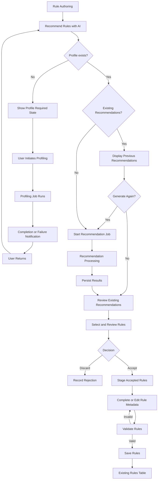
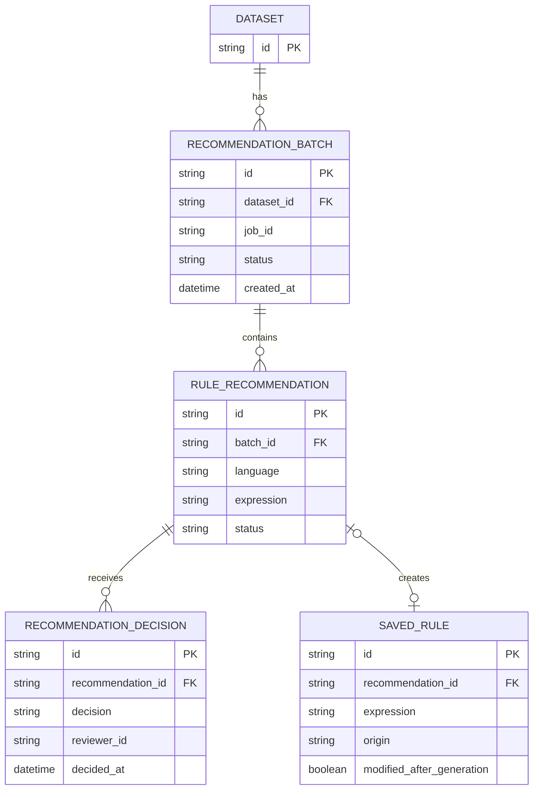

# Meeting 8 Analysis — AI Rule Recommendation

**Date:** November 13, 2026  
**Project:** AI-Powered Data Quality Rule Recommendation  
**Focus:** UI/UX Workflow, Profiling Dependencies, Recommendation Lifecycle, Rule Persistence

---

## 1. Executive Summary

Meeting 8 focused on defining the user experience for AI-powered rule recommendations within the existing Rule Authoring application.

The central question was:

> How does a user discover, review, accept, edit, and save AI-recommended data quality rules?

### Key Takeaways

1. **Rule generation and rule recommendation are separate experiences.** Natural-language-to-DQDL generation belongs in the existing Add/Edit Rule modal. Profile-driven recommendations require a separate review workflow.
2. **Profiling is a prerequisite for rule recommendation.** Users explicitly initiate profiling and subsequently request recommendations.
3. **Avoid automatic backend orchestration.** The system will not automatically run recommendations immediately after profiling completes.
4. **Recommendations need a dedicated review experience.** A grid-based UI should support potentially dozens of rules.
5. **AI should generate required rule metadata.** Rule names, descriptions, expressions, and relevant check types should be populated automatically where possible.
6. **Users should be able to accept, discard, and subsequently edit recommendations.**
7. **Recommendations must be persisted and recoverable.** Closing the UI should not cause suggestions to disappear.
8. **Existing recommendations should be shown before rerunning generation.** This reduces unnecessary LLM calls and duplicate suggestions.
9. **Recommendations are shared at the dataset/ruleset level, not owned exclusively by an individual user.**
10. **SQL and DQDL recommendations should follow a consistent user experience.**

**Overall assessment:** This meeting established the initial product-level blueprint for rule recommendations. However, recommendation statuses, acceptance semantics, persistence, and editing behavior require further clarification before implementation.

---

## 2. Decisions and Direction

| Topic | Meeting Direction | Status |
|---|---|---|
| Recommendation entry point | Separate "Recommend Rules with AI" action | Proposed |
| AI rule generation | Remains in existing Add/Edit Rule modal | Agreed |
| Profile availability | Check before recommending rules | Agreed |
| Missing profile | Guide user to run profiling | Agreed |
| Orchestration | No automatic profile-to-recommendation chaining | Agreed |
| Processing time | Recommendations may take minutes | Estimate, unverified |
| Recommendation presentation | Dedicated grid-based review experience | Agreed in principle |
| Bulk selection | Accept/discard multiple rules | Proposed |
| Editing recommendations | Accept first, then use existing editor | Tentative |
| Rule metadata | AI-generated and defaulted fields | Proposed |
| Existing recommendations | Retrieve previously generated suggestions | Agreed in principle |
| Duplicate prevention | Warn/show existing recommendations | Proposed |
| Shared ownership | Recommendations associated with dataset/ruleset | Agreed in principle |
| SQL and DQDL | Consistent workflow | Agreed |
| Product alignment | Review proposed experience Monday | Planned |

**Important:** Not every idea discussed was formally approved. Several were exploratory suggestions that need product confirmation.

---

## 3. Proposed End-to-End Workflow

### 3.1 Recommendation Flow



### 3.2 Important Workflow Constraint

The team specifically wants to avoid:

```text
Start Profiling
    ↓
Monitor Profiling Completion
    ↓
Automatically Trigger Recommendations
    ↓
Process Recommendation Results
```

This would require additional orchestration infrastructure and coordination between independent asynchronous processes.

Instead:

```text
User Runs Profile
    ↓
Profile Completes
    ↓
User Receives Notification
    ↓
User Returns to Rule Authoring
    ↓
User Explicitly Requests Recommendations
```

This approach reduces backend complexity while preserving the feature's core functionality.

---

## 4. Detailed Discussion Analysis

### 4.1 Rule Generation vs. Rule Recommendation

The team clarified that two different AI use cases must coexist.

| Capability | Generate Rule with AI | Recommend Rules with AI |
|---|---|---|
| Input | Natural-language prompt | Profiling metadata |
| Output | Individual generated rule | Potentially dozens of rules |
| Purpose | Author a specific rule | Discover useful data quality checks |
| User experience | Existing Add/Edit Rule modal | Dedicated recommendation workspace |
| User interaction | Generate, review, use | Review, accept, discard, edit |
| Prerequisites | LLM and rule validation | Completed profiling |
| Persistence | Existing rule save workflow | Suggestion lifecycle followed by rule save |

#### Recommendation

Do not force both capabilities into the same modal.

The Add/Edit Rule modal is designed for authoring individual rules. It is not suitable for reviewing 60 or more recommendations.

The two experiences should reuse common validation, metadata, and expression-editing components.

---

### 4.2 Profiling as a Prerequisite

Before initiating rule recommendation, the application must determine whether a usable profile exists.

#### Profile Available

1. User clicks "Recommend Rules with AI."
2. Backend verifies profiling metadata.
3. Application checks for previously generated recommendations.
4. User reviews existing results or starts a new recommendation job.

#### Profile Unavailable

1. User clicks "Recommend Rules with AI."
2. Application determines there is no usable profile.
3. UI displays a profile-required message.
4. User initiates profiling explicitly.
5. Profiling runs asynchronously.
6. Completion or failure notification is sent.
7. User returns to request recommendations.

#### Example UI Copy

**Dataset Profiling Required**

AI recommendations use profiling results to identify potential data quality rules.

Generate a profile for this dataset before requesting recommendations.

**Action:** Generate Profile

#### Engineering Considerations

A profile's existence is not necessarily sufficient.

The system should eventually distinguish between:

- No profile
- Profile queued
- Profiling running
- Profile completed
- Profiling failed
- Profile stale
- Profile incompatible with the selected dataset version

The MVP should at minimum distinguish usable, missing, running, and failed profiling states.

---

### 4.3 Asynchronous Recommendation Processing

Participants estimated that recommendation processing could take one or several minutes.

This estimate remains unverified.

Potential processing steps include:

1. Retrieve profile metadata.
2. Retrieve logical and physical metadata.
3. Perform relevant knowledge-base retrieval or similarity search.
4. Build LLM context.
5. Generate recommendations.
6. Validate the generated rule expressions.
7. Persist valid recommendation results.
8. Return recommendation status and results.

#### Recommended API Architecture

Rather than keeping a request open for minutes, use a job-based model.

```http
POST /rulesets/{rulesetId}/recommendations
```

Response:

```json
{
  "jobId": "job-123",
  "status": "PENDING"
}
```

Retrieve job status:

```http
GET /recommendation-jobs/{jobId}
```

Retrieve results:

```http
GET /rulesets/{rulesetId}/recommendations
```

Suggested job statuses:

```typescript
type RecommendationJobStatus =
  | "PENDING"
  | "RUNNING"
  | "COMPLETED"
  | "FAILED";
```

These endpoints and statuses are proposed designs, not confirmed backend contracts.

#### Frontend Implications

The UI should support:

- Loading and processing states
- Job failure states
- Retrieval of previously completed results
- Closing and reopening the experience
- Explicit regeneration
- Prevention of accidental duplicate job submissions

Avoid making the entire application depend on an indefinite loading spinner.

---

### 4.4 Recommendation Review Experience

One of the most significant UX considerations was recommendation volume.

For example:

```text
20 columns × 3 recommendations per column = 60 recommendations
```

A single-rule editing modal does not scale to this volume.

#### Recommended Design

Use a dedicated recommendation review workspace containing a DataGrid.

Suggested columns:

| Field | Purpose |
|---|---|
| Selection | Select recommendations for bulk actions |
| Column | Target dataset column |
| Rule Name | AI-generated suggested name |
| Rule Type | DQDL or SQL rule category |
| Check Type | Rule validation/check classification |
| Rule Expression | Read-only summary or preview |
| Status | Pending, accepted, or rejected |
| Actions | View details, accept, discard |

#### Suggested User Actions

- Select individual recommendations
- Select all eligible recommendations
- Accept selected
- Discard selected
- View rule details
- Review previous recommendations
- Regenerate recommendations
- Continue to rule editing

#### UX Recommendation

Avoid placing every editable field directly in the main DataGrid.

This would create an overly complex interface because rules may contain several required attributes.

Instead:

1. Display essential recommendation information in the grid.
2. Provide a details view for expanded information.
3. Let users select suggestions.
4. Allow further editing through the existing rule editing workflow.

---

### 4.5 Required Rule Metadata

The team identified a critical dependency between recommendation generation and rule persistence.

Producing a valid DQDL expression is not enough.

The generated recommendation must also satisfy the metadata requirements of the existing rule save process.

| Field | Potential Source | Suggested Behavior |
|---|---|---|
| Rule Name | AI-generated | Editable |
| Rule Description | AI-generated | Editable |
| Rule Expression | AI-generated | Parser-validated and editable |
| Rule Type | Recommendation context | Automatically populated |
| Rule Check Type | Expression metadata | Automatically populated and validated |
| Rule Monitor | Ruleset configuration | Default when only one exists |
| Minimum Quality Score | Product-defined default | Proposed default of 100 |
| Maximum Error Count | Product/user configuration | Requires clarification |
| Column Name | Profiling metadata | Automatically populated |
| AI Provenance | Recommendation metadata | Persisted |

#### Rule Monitor Behavior

The team proposed:

- If only one rule monitor exists, automatically select it.
- If multiple rule monitors exist, allow the user to choose.

This reduces unnecessary user interaction while respecting existing validation requirements.

#### Important Open Question

The team suggested defaulting the minimum quality score to 100.

That value should be explicitly confirmed with product.

The correct default may depend on rule type, business criticality, or organizational policy.

#### Recommended Backend Responsibility

The recommendation service should return a structured rule suggestion, including:

- Rule identity
- Rule name
- Rule description
- Rule expression
- Rule type
- Rule check type
- Target column
- Available/default metadata
- Validation status

The frontend should not be responsible for independently inferring every required field from a generated expression.

---

### 4.6 Editing Accepted Recommendations

The team tentatively suggested that users should accept recommendations before editing them through the existing rule editor.

However, another important issue arose:

> Does an edited AI-generated rule stop being an AI-generated rule?

#### Recommendation

No. Editing should not erase the rule's origin.

There are two distinct concepts:

**Provenance**

How was the original rule created?

**Modification State**

Has the rule been changed since it was generated?

Recommended TypeScript model:

```typescript
type RuleProvenance = {
  origin:
    | "AI_RECOMMENDATION"
    | "AI_GENERATION"
    | "MANUAL";

  recommendationId?: string;
  modifiedAfterGeneration: boolean;
};
```

Example:

```json
{
  "origin": "AI_RECOMMENDATION",
  "recommendationId": "recommendation-123",
  "modifiedAfterGeneration": true
}
```

This preserves AI attribution even when a human modifies the resulting rule.

#### Why This Matters

Without provenance tracking, reporting becomes misleading.

The team may eventually want to measure:

- Total recommendations generated
- Recommendations accepted
- Recommendations rejected
- Accepted recommendations subsequently edited
- Saved rules originating from AI
- Rule execution performance
- Frequency of user corrections to AI output

These metrics require preserving the relationship between recommendations and saved rules.

---

### 4.7 Persisting and Recovering Recommendations

The meeting raised an important scenario:

A user generates recommendations, closes the interface, and later returns.

The user should not be required to run the LLM again simply to retrieve the previous results.

#### Recommended Behavior

When the user opens the recommendation experience:

1. Identify the relevant dataset/ruleset.
2. Query existing recommendation batches.
3. Display previously generated suggestions.
4. Show existing acceptance/rejection states.
5. Provide an explicit option to regenerate.

#### Example

```text
AI Rule Recommendations

Previous recommendations found.

Last generated: November 13, 2026
Recommendations: 60

[View Recommendations] [Generate Again]
```

#### Data Ownership

The team clarified that recommendations should be associated with the dataset/ruleset rather than being private to the person who generated them.

This supports collaboration across a shared ruleset.

However, recommendation ownership and reviewer attribution should be treated separately.

A shared recommendation can still record:

- Who requested generation
- Who accepted it
- Who rejected it
- When decisions occurred

---

### 4.8 Duplicate Recommendation Prevention

Two duplicate scenarios were discussed.

#### Scenario A: Repeated Generation

A user generates and accepts 100 rules, then runs AI recommendation again and accepts another 100.

The second batch may contain rules equivalent to the first.

#### Scenario B: Multiple Users

User A generates recommendations for a dataset.

User B later opens the same dataset without knowing previous recommendations already exist.

#### Proposed Controls

**Frontend Controls**

- Display existing recommendations before generating new ones.
- Warn users that recommendations already exist.
- Require an explicit regeneration action.

**Backend Controls**

- Compare generated recommendations against existing rules.
- Check for duplicate expressions.
- Maintain links to previous recommendation batches.
- Avoid inserting duplicate persisted rules.

#### Recommendation

Frontend warnings are useful, but they are not sufficient.

The backend should enforce duplicate checks at persistence time.

Rule names alone should not determine uniqueness.

For example:

```text
IsComplete "customer_email"
```

and another rule with the same logic but a different name may still be duplicates.

Start with normalized expressions scoped to the correct dataset/ruleset and evolve toward semantic duplicate detection if needed.

---

### 4.9 SQL and DQDL Consistency

The team emphasized that both SQL and DQDL rule recommendations should follow similar user experiences.

This does not mean both must use identical rule editors or persistence schemas.

#### Shared Workflow

- Check profiling status
- Start recommendation job
- Display job progress
- Retrieve prior recommendations
- Review suggested rules
- Accept or reject
- Edit metadata
- Validate
- Save
- Regenerate

#### DQDL-Specific Logic

- DQDL expression rendering
- DQDL parser validation
- DQDL rule check types
- DQDL-specific metadata

#### SQL-Specific Logic

- SQL expression rendering
- SQL syntax and semantic validation
- SQL rule classifications
- SQL-specific metadata

#### Engineering Recommendation

Share workflow components while isolating language-specific validation and editing logic.

---

## 5. Recommended React/TypeScript Architecture

### Proposed Component Hierarchy

```text
RuleAuthoring/
├── AuthorDataQualityRule/
│   ├── AddRuleModal.tsx
│   ├── ManualRuleEditor.tsx
│   └── AIRuleGeneration.tsx
│
├── RuleRecommendations/
│   ├── RuleRecommendationEntry.tsx
│   ├── ProfileRequiredState.tsx
│   ├── RecommendationJobStatus.tsx
│   ├── RecommendationReview.tsx
│   ├── RecommendationDataGrid.tsx
│   ├── RecommendationDetails.tsx
│   └── RecommendationActions.tsx
│
├── shared/
│   ├── RuleMetadataFields.tsx
│   ├── RuleExpressionEditor.tsx
│   └── RuleValidation.ts
│
└── hooks/
    ├── useProfileStatus.ts
    ├── useRuleRecommendations.ts
    └── useRecommendationJob.ts
```

### Architecture Principles

1. Keep AI rule recommendation separate from the existing manual rule authoring experience.
2. Reuse existing rule validation and expression editor components.
3. Use the existing MDS design system and MUI DataGrid patterns.
4. Separate backend recommendation state from wizard form state.
5. Only transfer selected, validated rules into the existing authoring workflow.
6. Keep recommendation data retrievable after navigation or modal closure.
7. Represent asynchronous jobs explicitly.

### Suggested Recommendation Type

```typescript
type RuleLanguage = "DQDL" | "SQL";

type RecommendationStatus =
  | "PENDING"
  | "ACCEPTED"
  | "REJECTED";

type RuleRecommendation = {
  id: string;
  batchId: string;
  rulesetId: string;

  language: RuleLanguage;
  columnName?: string;

  name: string;
  description: string;
  expression: string;

  ruleType: string;
  ruleCheckType: string;

  minQualityScore?: number;
  maxErrorCount?: number;
  ruleMonitorId?: string;

  status: RecommendationStatus;

  createdAt: string;
  acceptedRuleId?: string;
};
```

This is a proposed frontend contract, not an agreed database schema.

The backend will need a stable dataset identity in addition to any ruleset identifier.

### State Management Consideration

Avoid placing all generated recommendations directly into `addedDqdlRules`.

Recommended separation:

```text
Recommendation Server State
    ↓
User Reviews Suggestions
    ↓
Accepted Selection
    ↓
Metadata Completion and Validation
    ↓
Existing Rules Workflow
    ↓
Persisted Rules
```

This prevents unreviewed suggestions from accidentally becoming part of a ruleset.

---

## 6. Relationship to Meeting 7 Database Design

Meeting 7 discussed consolidating recommendation-related tables and how to represent rule origination and acceptance.

Meeting 8 clarifies the behaviors that the database must support.

### Required Relationships



This is a conceptual model rather than a finalized schema.

A simpler MVP may combine decisions into the recommendation record, provided the design can still support required history and auditability.

### Important Modeling Distinction

**Recommendation Batch**

Represents one generation attempt and its job metadata.

**Rule Recommendation**

Represents one suggested rule produced by the batch.

**Recommendation Decision**

Represents user review actions.

**Saved Rule**

Represents an actual data quality rule persisted through the normal rule creation process.

These should remain conceptually distinct even if some storage is consolidated.

---

## 7. Unresolved Questions for Product

### Question 1: Acceptance Semantics

Does accepting a recommendation immediately create a rule?

Or does accepting stage it until a final Save operation?

**Recommendation:** Use a two-stage workflow:

1. Accept/select recommendations.
2. Complete required fields, validate, and save.

### Question 2: Editing Before Save

Can users modify a recommendation before accepting it?

Or must they accept first and then edit it?

**Recommendation:** Allow detailed inspection before acceptance, while reusing the normal rule editor for actual modifications.

### Question 3: Previously Rejected Suggestions

Should rejected recommendations remain visible?

Can users reverse their decision?

**Recommendation:** Preserve rejected suggestions with reversible review actions where appropriate.

### Question 4: Regeneration Behavior

Should regeneration replace existing suggestions or create a new batch?

**Recommendation:** Create a new batch and preserve previous batches.

### Question 5: Shared Reviewer Decisions

If User A rejects a suggestion, should User B still see it?

**Recommendation:** Define whether rejection is a shared ruleset-level decision. Preserve individual reviewer attribution regardless.

### Question 6: Required Metadata

Which fields can be inferred, defaulted, or left for users?

**Recommendation:** Establish a backend/frontend contract that explicitly identifies required fields and defaulting rules.

### Question 7: Validation

At what point should validation occur?

**Recommendation:** Validate AI output before presenting it and revalidate the final edited rule before saving.

### Question 8: Duplicate Detection

How does the system identify equivalent rules across recommendation batches?

**Recommendation:** Begin with normalized expression comparison and expand if required.

### Question 9: Profiling Freshness

Can recommendations be generated from an older profile?

**Recommendation:** Define profile freshness requirements and dataset-version compatibility.

### Question 10: Recommendation Scope

Are recommendations associated with the dataset, distribution, ruleset, or a combination?

**Recommendation:** Finalize a stable dataset identity and ruleset relationship before implementing persistence and caching.

---

## 8. Meeting 6, 7, and 8 Comparison

| Topic | Meeting 6 | Meeting 7 | Meeting 8 |
|---|---|---|---|
| Main focus | Scope and orchestration | Data model | UX and workflow |
| Profiling | User-triggered prerequisite | Not primary focus | Explicit availability check |
| Notifications | Profiling success/failure | Not primary focus | Confirmed as part of user journey |
| Draft rules | Introduced | Storage considerations | Review/accept/edit experience |
| Recommendation storage | High-level requirement | Table consolidation discussion | Persistence and recovery required |
| AI provenance | Tracking needed | Origination relationship | Edited AI-generated rules discussed |
| SQL/DQDL | Multiple use cases | Shared/separate schema concerns | Consistent UI workflow |
| Duplicates | Not primary focus | Related to data relationships | Explicit regeneration concern |
| Product approval | Feature scope | Architecture discussion | UI review proposed for Monday |

### Evolution of the Project

**Meeting 6: What are we building?**

The team narrowed the scope and removed expensive orchestration work.

**Meeting 7: How should the information be stored?**

The team discussed suggestion tables, origination relationships, and feedback tracking.

**Meeting 8: How will users actually use the feature?**

The team explored the full lifecycle of generated recommendations.

### Architectural Concern

The persistence model should not be finalized independently of the recommendation review workflow.

User actions determine which states and relationships the backend must support.

---

## 9. Recommended Action Items

### Frontend / UX

- [ ] Create a prototype for the recommendation entry point.
- [ ] Design the profile-required state.
- [ ] Design recommendation loading and failure states.
- [ ] Design a DataGrid for 60+ recommendations.
- [ ] Define bulk accept/discard behavior.
- [ ] Design recommendation details and editing interactions.
- [ ] Support retrieving previously generated suggestions.
- [ ] Design regeneration confirmation or existing-results notice.
- [ ] Ensure consistent interaction patterns for SQL and DQDL.

### Backend / API

- [ ] Define the profile availability endpoint.
- [ ] Define the recommendation generation endpoint.
- [ ] Define asynchronous job status handling.
- [ ] Define the recommendation response contract.
- [ ] Return required rule metadata.
- [ ] Define validation responsibilities.
- [ ] Implement recommendation persistence.
- [ ] Preserve provenance.
- [ ] Define duplicate detection.
- [ ] Support previous recommendation retrieval.

### Product

- [ ] Approve recommendation entry point.
- [ ] Approve review experience.
- [ ] Define Accept vs. Save behavior.
- [ ] Define rejection and reversal behavior.
- [ ] Define metadata defaults.
- [ ] Clarify rule monitor assignment.
- [ ] Confirm recommendation scope and shared ownership.
- [ ] Define acceptable regeneration behavior.
- [ ] Confirm SQL/DQDL experience consistency.

---

## 10. Engineering Assessment

The most consequential frontend questions raised in this meeting concerned the lifecycle of recommendations rather than their visual presentation.

These included:

- How users navigate large recommendation sets.
- How required rule fields are populated.
- Whether recommendations can be edited.
- How accepted recommendations transition into persisted rules.
- How duplicate suggestions are avoided.
- How prior recommendations are recovered.
- How different users interact with shared recommendation results.
- How SQL and DQDL workflows remain consistent.

These decisions directly affect API contracts, database relationships, state management, and product behavior.

### Leadership Opportunity

For Monday's discussion, bring one coherent prototype rather than only a collection of questions.

Recommended screens:

1. **Profile Required:** Explains the prerequisite and how to initiate profiling.
2. **Recommendation Review:** Displays suggestions, previous results, bulk selection, and accept/discard actions.
3. **Accepted Rule Editing:** Shows how selected suggestions enter the existing rule validation/save workflow.

Alongside the prototype, present the unresolved product decisions and the technical implications of each choice.

This positions frontend engineering as a contributor to system design, not merely UI implementation.

---

## 11. Final Recommendations

### Recommendation 1: Separate Generation from Recommendation

Maintain the existing Add/Edit Rule modal for manual and natural-language-assisted authoring.

Create a dedicated workflow for profile-driven recommendations.

### Recommendation 2: Make Profiling an Explicit Prerequisite

Do not introduce automatic orchestration between profile completion and recommendation execution for the MVP.

### Recommendation 3: Use a Persistent Recommendation Lifecycle

Do not treat generated suggestions as transient UI data.

Persist recommendation batches, individual suggestions, review decisions, and links to saved rules.

### Recommendation 4: Preserve AI Provenance

An AI-generated rule remains AI-originated even after human modification.

Track modification separately.

### Recommendation 5: Centralize Validation and Duplicate Prevention

The backend should enforce validity and uniqueness constraints.

The frontend should support useful review and feedback interactions but should not be the only enforcement layer.

### Recommendation 6: Share Workflow Across SQL and DQDL

Reuse common recommendation components while isolating language-specific rule editors and validators.

### Recommendation 7: Finalize Product Semantics Before Database Implementation

Acceptance, rejection, regeneration, saving, and editing must have clearly defined meanings.

These decisions should drive API contracts and storage design.

---

## 12. Final Takeaway

Meeting 8 established the emerging end-to-end lifecycle:

**Generate Recommendations → Persist Suggestions → Review → Accept or Reject → Edit → Validate → Save as Rules**

The most important architectural principle is to distinguish a recommendation from a saved data quality rule.

A recommendation is a proposed rule awaiting a user decision.

A saved rule is an approved, validated rule that participates in the normal data quality execution lifecycle.

Keeping those concepts separate enables reliable review, persistence, auditability, provenance tracking, regeneration, and duplicate prevention.

**Suggested next step:** Prepare the recommendation review prototype and use Monday's product discussion to finalize acceptance semantics, editing behavior, and required metadata.
