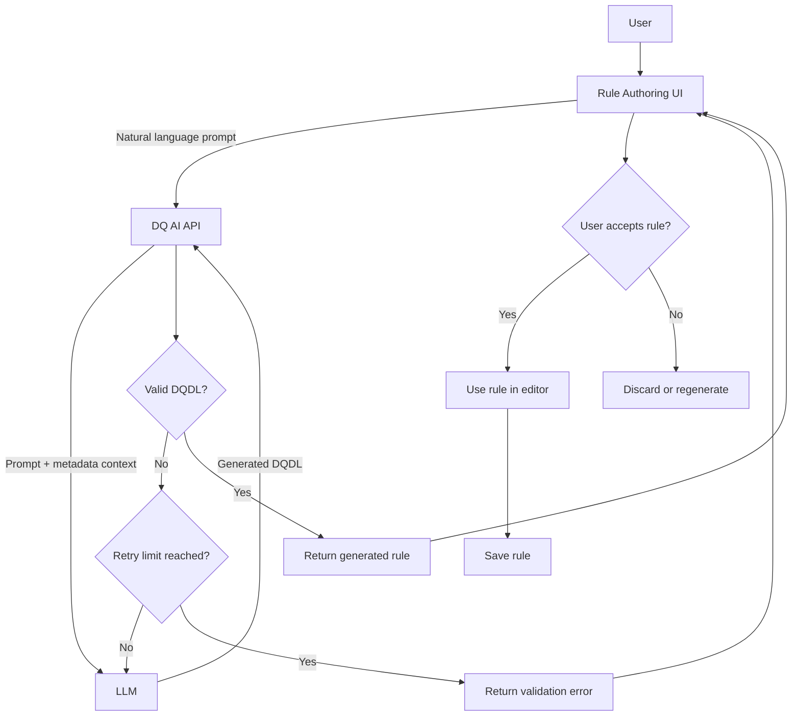
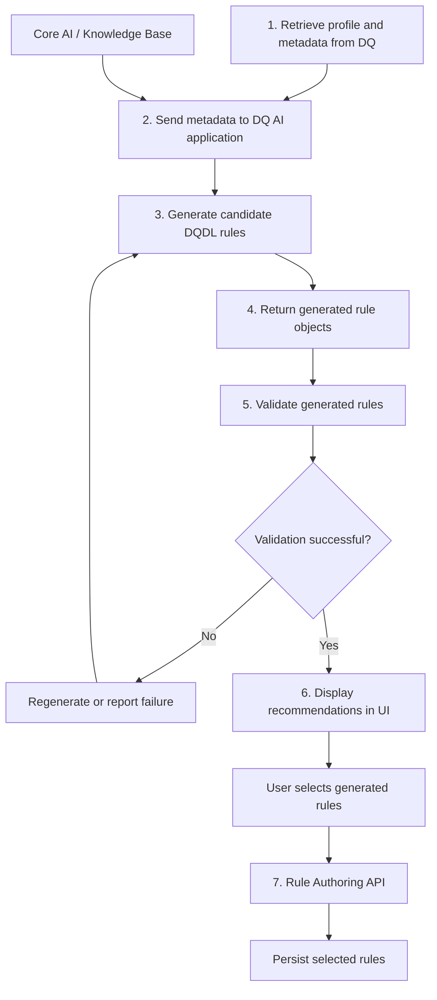
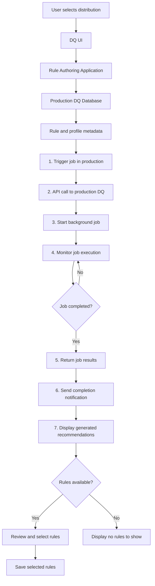
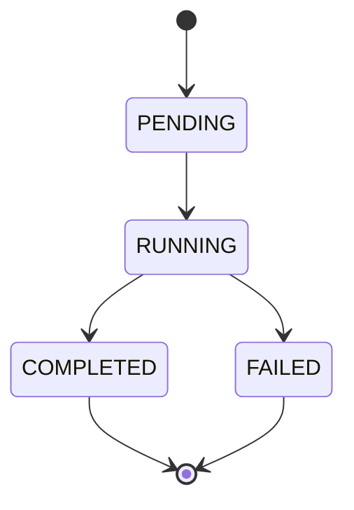

# AI-Powered Data Quality Rule Generation — Architecture and Workflows

Based on two whiteboard photos, the following documents three interpreted workflows. Mermaid diagrams can render in GitHub, GitLab, and compatible Markdown editors.

## 1. AI-Powered DQDL Rule Generation Architecture

### Workflow Description

1. User enters a natural-language description in the Rule Authoring UI.
2. UI sends the prompt to the DQ AI API.
3. API supplies the prompt and relevant metadata to the LLM.
4. LLM generates a candidate DQDL expression.
5. API validates the generated expression.
6. Invalid expressions trigger retries until the configured limit is reached.
7. Valid expressions return to the UI.
8. User accepts, discards, or regenerates the rule.
9. Accepted rules populate the editor and can subsequently be saved.

## 2. Metadata-Driven AI Rule Recommendation

### Workflow Description

1. Retrieve profiling and metadata information from the Data Quality system.
2. Supply the retrieved context to the DQ AI application.
3. Generate recommended rules using the AI model and knowledge base.
4. Return generated DQDL rule objects.
5. Validate the rules against DQDL requirements.
6. Present successfully validated recommendations in the UI.
7. Allow users to select and persist recommended rules through the Rule Authoring API.

## 3. Production Rule Execution and Notification Workflow

### Workflow Description

1. User selects a distribution through the DQ UI.
2. Application retrieves relevant metadata from the production DQ database.
3. A job is triggered through the production DQ API.
4. Background processing executes the recommendation workflow.
5. System monitors execution status.
6. Completed jobs return recommendation results.
7. User receives a completion notification.
8. UI displays available recommendations.
9. User reviews and saves selected rules.

## 4. Architecture Observations

### Synchronous Generation

The user initiates generation by entering a natural-language prompt.

**Characteristics:**
- Request-response interaction.
- Immediate validation feedback.
- Retry handling for invalid generated rules.
- User explicitly accepts generated content.
- Rule persistence occurs separately from generation.

### Asynchronous Recommendation

The system generates recommendations using distribution profiling and metadata.

**Characteristics:**
- Background job execution.
- Metadata-driven generation.
- Job status tracking.
- Completion notifications.
- Recommendations available for later review.
- User selection before persistence.

### Recommended Job Lifecycle

A job-based architecture should expose a `jobId` and explicit statuses such as `PENDING`, `RUNNING`, `COMPLETED`, and `FAILED`.

## 5. Implementation Considerations

| Component | Responsibility |
|---|---|
| Rule Authoring UI | Prompt input, rule review, selection, and acceptance |
| DQ AI API | AI generation orchestration and response handling |
| LLM | Generate DQDL expressions |
| Knowledge Base | Supply metadata and domain context |
| Validation Service | Validate generated DQDL |
| Production DQ API | Trigger and manage production jobs |
| Background Processor | Execute asynchronous recommendation jobs |
| Notification Service | Notify users of job completion |
| Rule Authoring API | Persist accepted rules |

## 6. Open Design Questions

- Should AI generation and metadata-driven recommendations share the same backend orchestration service?
- Where should DQDL validation occur?
- What is the maximum retry count for invalid AI-generated expressions?
- How should generated recommendations be stored before user acceptance?
- Should background job completion use polling, Server-Sent Events, or another notification mechanism?
- How should duplicate or previously accepted recommendations be handled?
- Should generation history and user acceptance metrics be persisted separately from published rules?

---

**Note:** These diagrams are interpreted from the whiteboard photos rather than exact transcriptions. Some handwritten labels are partially obscured or illegible. The workflows should be reviewed against the team's intended API contracts and implementation decisions before being treated as final architecture.
